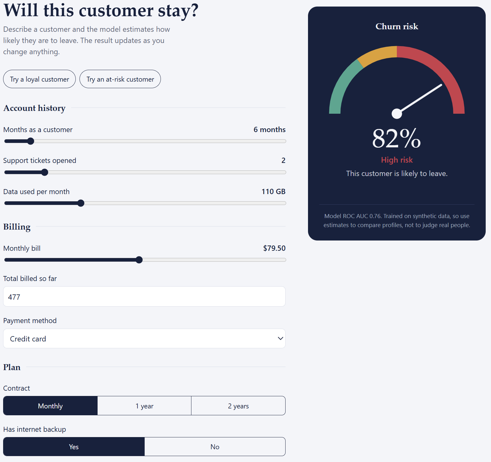
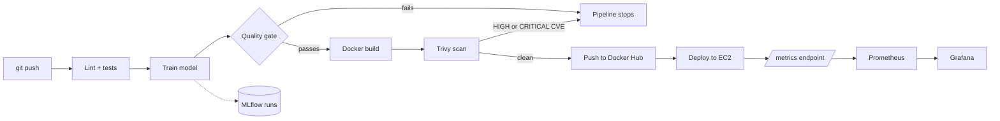
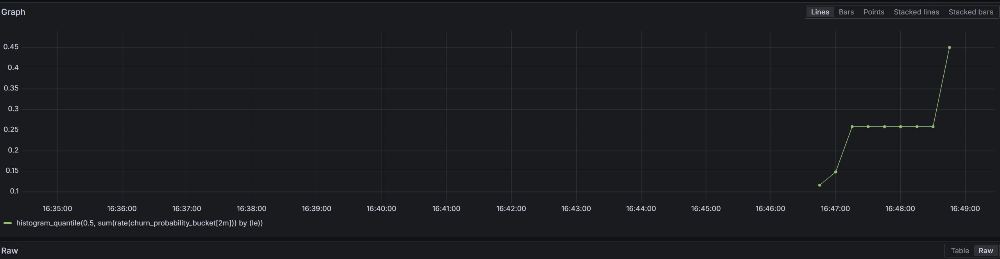
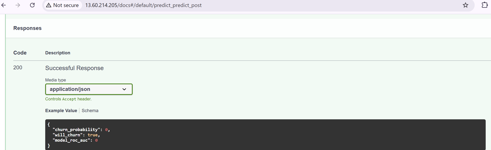

<div align="center">

# Churn MLOps

**An end-to-end machine learning pipeline: from `git push` to a tested, quality-gated, security-scanned, deployed and monitored prediction service.**

[](https://github.com/ruchitasingla/churn-mlops/actions/workflows/ci-cd.yml)




</div>

---

## Contents

[Overview](#overview) · [What it demonstrates](#what-it-demonstrates) · [Architecture](#architecture) · [The pipeline](#the-pipeline-stage-by-stage) · [Screenshots](#screenshots) · [Quickstart](#quickstart) · [API reference](#api-reference) · [Quality gate](#the-model-quality-gate) · [Monitoring](#monitoring-and-drift-detection) · [CI/CD setup](#cicd-setup) · [Deploying to EC2](#deploying-to-aws-ec2) · [Configuration](#configuration) · [Project layout](#project-layout) · [Lessons learned](#lessons-learned) · [Roadmap](#roadmap)

## Overview

Most ML tutorials stop at "the model works in a notebook". This project is about everything after that: how a model gets **trained reproducibly, judged automatically, packaged, scanned, shipped, served and watched**.

The model predicts whether a telecom-style customer is likely to leave (churn), from eight inputs such as contract type, tenure, monthly bill and support tickets. It is served through a FastAPI service with a small web UI, and every change to `main` flows through a fully automated pipeline.

| | |
|---|---|
| **Model** | scikit-learn `Pipeline` (scaling + one-hot encoding + Gradient Boosting), ROC AUC around 0.76 |
| **Data** | Seeded synthetic dataset, so CI needs no downloads and drift can be simulated on demand |
| **Serving** | FastAPI + Uvicorn, validated inputs, a web UI at `/`, Swagger docs at `/docs` |
| **Image** | Multi-stage build, non-root user, built-in healthcheck, about 157 MB compressed |

> [!NOTE]
> The data is synthetic and the model is a demonstration. It is not a tool for judging real people.

## What it demonstrates

| Skill area | How it shows up in this repo |
|---|---|
| **Reproducible ML** | Fixed seeds, one `Pipeline` object so preprocessing ships with the model, dependency versions pinned |
| **Experiment tracking** | MLflow records parameters, metrics, the model artifact and the quality-gate verdict for every run |
| **Automated model validation** | A quality gate blocks the pipeline when a new model is too weak or worse than production |
| **CI/CD** | GitHub Actions: lint, test, train, build, scan, publish, deploy, in dependency order |
| **Container security** | Trivy scans every image and fails the build on fixable HIGH or CRITICAL vulnerabilities |
| **Secrets hygiene** | Credentials live only in GitHub Secrets; push protection is enabled |
| **Cloud deployment** | Image deployed to AWS EC2 over SSH, with a post-deploy health check that fails the run if the container is unhealthy |
| **Observability** | Prometheus metrics (latency, request counts, prediction distribution) and a Grafana view of data drift |
| **Testing** | Unit tests for data, gate logic and training; API tests for validation, scoring and metrics |

## Architecture



## The pipeline, stage by stage


| Stage | What happens | Fails the run when |
|---|---|---|
| **lint-and-test** | `ruff` lint and format check, then `pytest` with coverage | Style errors or any failing test |
| **train** | Trains on a seeded dataset, logs to MLflow, applies the quality gate, uploads the model as an artifact | ROC AUC is below the floor or regresses against production |
| **build-scan-push** | Builds the image with the gated model inside it, scans it with Trivy, pushes to Docker Hub (only on `main`) | A fixable HIGH or CRITICAL vulnerability is found |
| **deploy** | SSHes into EC2, pulls the new image, restarts the container, polls `/health` | The new container does not become healthy within 30 seconds |

Pull requests run everything up to the scan. Only pushes to `main` publish an image. The deploy job is opt-in (see [CI/CD setup](#cicd-setup)), which is why it appears as skipped when no server is configured.

## Screenshots

<table>
<tr>
<td width="50%"><b>Quality gate in MLflow</b><br>Runs compared side by side. The gate verdict and its reason are stored as tags.<br></td>
<td width="50%"><b>Drift in Grafana</b><br>Median predicted churn probability rises when incoming customers stop looking like the training data.<br></td>
</tr>
<tr>
<td width="50%"><b>Published image</b><br>Built, scanned and pushed by the pipeline.<br></td>
<td width="50%"><b>Live deployment on AWS EC2</b><br>A prediction served by the container the pipeline deployed. (Captured during a deployment run; the instance was terminated afterwards to avoid cost.)<br></td>
</tr>
</table>

**The model reacts sensibly to its inputs**: a month-to-month customer with 12 months of tenure scores 0.66, while a two-year customer with 60 months and no support tickets scores 0.04.

| Higher risk | Lower risk |
|---|---|
|  |  |

## Quickstart

Requires **Python 3.10 or newer**. Commands are shown for macOS/Linux, with PowerShell equivalents where they differ.

```bash
git clone https://github.com/ruchitasingla/churn-mlops.git
cd churn-mlops

python -m venv .venv
source .venv/bin/activate              # PowerShell: .venv\Scripts\Activate.ps1
pip install -r requirements-dev.txt

pytest                                  # run the tests

# train (applies the quality gate and writes models/model.joblib)
PYTHONPATH=src python -m churn_mlops.train          # PowerShell: $env:PYTHONPATH="src"; python -m churn_mlops.train

# serve
PYTHONPATH=src uvicorn churn_mlops.api:app --reload
```

Then open:

| URL | What you get |
|---|---|
| http://localhost:8000 | The web UI |
| http://localhost:8000/docs | Interactive API docs |
| http://localhost:8000/metrics | Prometheus metrics |

Browse experiment runs with `mlflow ui` and open http://localhost:5000.

**Or run the published image** (no Python needed):

```bash
docker run -p 8000:8000 ruchitasingla/churn-mlops-api:latest
```

## API reference

| Method | Path | Description |
|---|---|---|
| `GET` | `/` | Web UI |
| `GET` | `/health` | Liveness and whether the model is loaded |
| `POST` | `/predict` | Score one customer |
| `GET` | `/metrics` | Prometheus metrics |
| `GET` | `/docs` | Swagger UI |

```bash
curl -X POST localhost:8000/predict -H 'Content-Type: application/json' -d '{
  "tenure_months": 3,
  "monthly_charges": 95,
  "total_charges": 285,
  "support_tickets": 4,
  "avg_monthly_usage_gb": 80,
  "contract_type": "month-to-month",
  "payment_method": "e-wallet",
  "has_internet_backup": "no"
}'
```

```json
{ "churn_probability": 0.7445, "will_churn": true, "model_roc_auc": 0.7628 }
```

Inputs are validated: out-of-range numbers or unknown categories return `422` with a description of the problem.

## The model quality gate

`src/churn_mlops/train.py` evaluates every new model on a held-out split and **refuses to promote it** when:

1. `roc_auc` is below `MIN_ROC_AUC` (default `0.70`), or
2. it regresses against the current production model in `models/metrics.json` by more than `MIN_IMPROVEMENT` (default `-0.005`).

A failed gate exits with code 1, so the `train` job fails and nothing is built or deployed. The run is still logged in MLflow with `quality_gate: failed` and the reason, which gives a full audit trail of rejected models.

> [!TIP]
> The small negative tolerance absorbs run-to-run noise, but it also lets quality erode slowly over many retrains. Set `MIN_IMPROVEMENT=0` for a strict gate.

## Monitoring and drift detection

The API exposes Prometheus metrics: request counts and latency histograms, a counter of predictions by label, and a histogram of predicted churn probabilities. A Docker Compose stack wires up Prometheus and Grafana.

```bash
python -m churn_mlops.train                  # the API image needs a trained model
docker compose up --build -d                 # api :8000, mlflow :5000, prometheus :9090, grafana :3000
python scripts/send_traffic.py --n 300                # normal traffic
python scripts/send_traffic.py --n 300 --drift 1.0    # drifted traffic
```

Grafana runs at http://localhost:3000 (login `admin` / `admin`) with Prometheus already connected. In **Explore**, try:

```
histogram_quantile(0.5, sum(rate(churn_probability_bucket[1m])) by (le))
```

Drifted traffic (newer customers, higher bills, more tickets) pushes the median prediction up with no change to the model. That shift in the *output distribution* is the signal a monitoring job would use to trigger retraining. Stop the stack with `docker compose down`.

## CI/CD setup

Add these under **Settings, Secrets and variables, Actions**. In the secret form, the value goes in the **Secret** box, not the **Name** box.

| Name | Type | Value |
|---|---|---|
| `DOCKERHUB_USERNAME` | Secret | Docker Hub username (lowercase) |
| `DOCKERHUB_TOKEN` | Secret | Docker Hub access token with Read & Write permission |
| `EC2_HOST` | Secret | Public IP of the EC2 instance |
| `EC2_USER` | Secret | `ubuntu` |
| `EC2_SSH_KEY` | Secret | Full contents of the `.pem` private key |
| `DEPLOY_ENABLED` | **Variable** | `true` to switch the deploy job on |

Without `DEPLOY_ENABLED=true`, the pipeline stops after publishing the image and shows `deploy` as skipped. This keeps forks and fresh clones green without needing a server.

## Deploying to AWS EC2

1. Launch an **Ubuntu 24.04** `t3.micro` (or `t2.micro`) instance, x86-64, with a new key pair.
2. Security group: allow **SSH (22)** and **HTTP (80)**.
3. In *Advanced details, User data*, paste this so Docker is installed on first boot:
   ```bash
   #!/bin/bash
   apt-get update -y
   apt-get install -y docker.io curl
   systemctl enable --now docker
   usermod -aG docker ubuntu
   ```
4. Make the Docker Hub repository **public** (the server pulls without logging in).
5. Add the `EC2_*` secrets, set `DEPLOY_ENABLED` to `true`, and push to `main`.
6. Open `http://<public-ip>/docs`.

> [!WARNING]
> Port 22 is open to the internet so that GitHub-hosted runners can connect, and login is protected by the key only. That is acceptable for a short-lived demo. For anything longer-lived, use a self-hosted runner or AWS Systems Manager and restrict SSH. Terminate the instance when you are done.

## Configuration

All settings can be overridden with environment variables.

| Variable | Default | Purpose |
|---|---|---|
| `MIN_ROC_AUC` | `0.70` | Minimum ROC AUC a model must reach to pass the gate |
| `MIN_IMPROVEMENT` | `-0.005` | Allowed change in ROC AUC versus production |
| `MODEL_DIR` | `./models` | Where the promoted model and its metrics are stored |
| `MLFLOW_TRACKING_URI` | `file:./mlruns` | MLflow backend |
| `MLFLOW_EXPERIMENT` | `churn-prediction` | MLflow experiment name |

Training options: `python -m churn_mlops.train --n-estimators 300 --max-depth 4 --learning-rate 0.05 --n-samples 5000`.

## Project layout

```
.
├── src/churn_mlops/
│   ├── api.py            FastAPI app: /, /predict, /health, /metrics
│   ├── train.py          training, evaluation, quality gate, promotion
│   ├── pipeline.py       scikit-learn Pipeline definition
│   ├── data.py           seeded synthetic data generator (with drift option)
│   ├── config.py         settings and environment overrides
│   └── static/index.html the web UI
├── tests/                data, gate logic, training, API contract and metrics
├── monitoring/           Prometheus and Grafana provisioning
├── scripts/              traffic and drift simulator
├── docs/                 screenshots
├── Dockerfile            multi-stage, non-root, healthcheck
├── docker-compose.yml    api + MLflow + Prometheus + Grafana
└── .github/workflows/    ci-cd.yml
```

## Lessons learned

- **The scanner earned its keep.** The first build was blocked because the pinned FastAPI pulled in Starlette 0.41.3, which carried three HIGH CVEs (CVE-2025-62727, CVE-2026-48818, CVE-2026-54283). Fixing it meant upgrading FastAPI and pinning a patched Starlette.
- **Tags are not immutable.** A version-tagged GitHub Action I first used no longer resolved after a 2026 supply-chain compromise of its tags. Pinning actions to a full commit SHA is the stronger practice.
- **Secrets never belong in files.** GitHub push protection stopped a token that had been pasted into the workflow before it reached the repository, and the token was revoked.
- **Docker image names must be lowercase**, so the pipeline normalises the name derived from the Docker Hub username.
- **A green pipeline can still hide a wrong value.** The Docker Hub login failed repeatedly until a presence check showed that the secrets were saved under the wrong names. Making failures observable beats guessing.

## Roadmap

- [ ] Compare against the last *deployed* model in CI by persisting `metrics.json` in S3 or an MLflow registry stage, instead of only enforcing the absolute AUC floor
- [ ] Scheduled drift check (Evidently) that triggers a retraining workflow
- [ ] Terraform for the EC2 instance, security group and key pair
- [ ] Pin all GitHub Actions to commit SHAs and enable Dependabot
- [ ] Blue/green or canary deploys, and a committed Grafana dashboard

## License

MIT. See `LICENSE`.