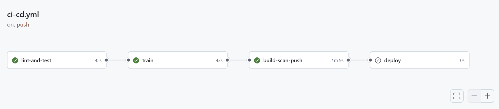
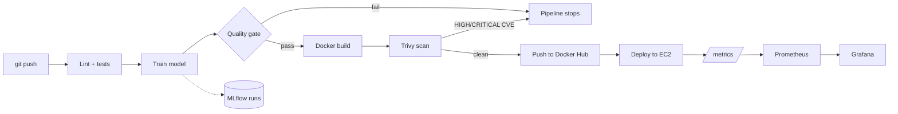
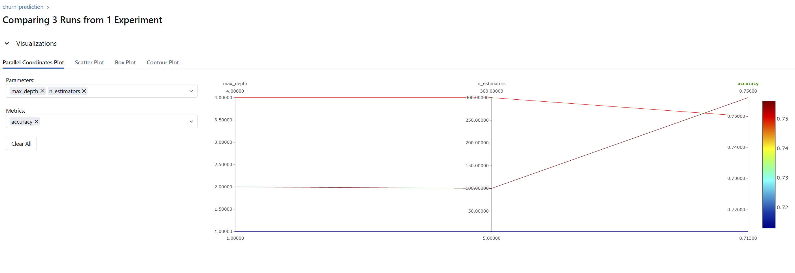
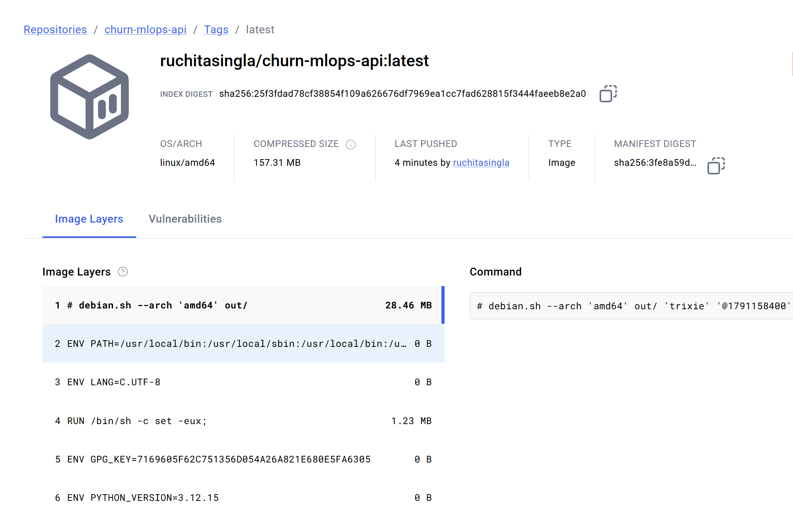
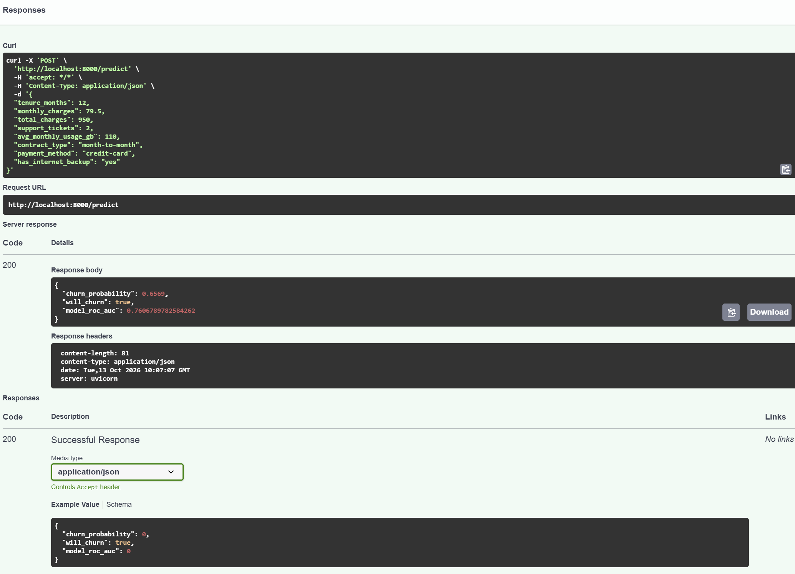
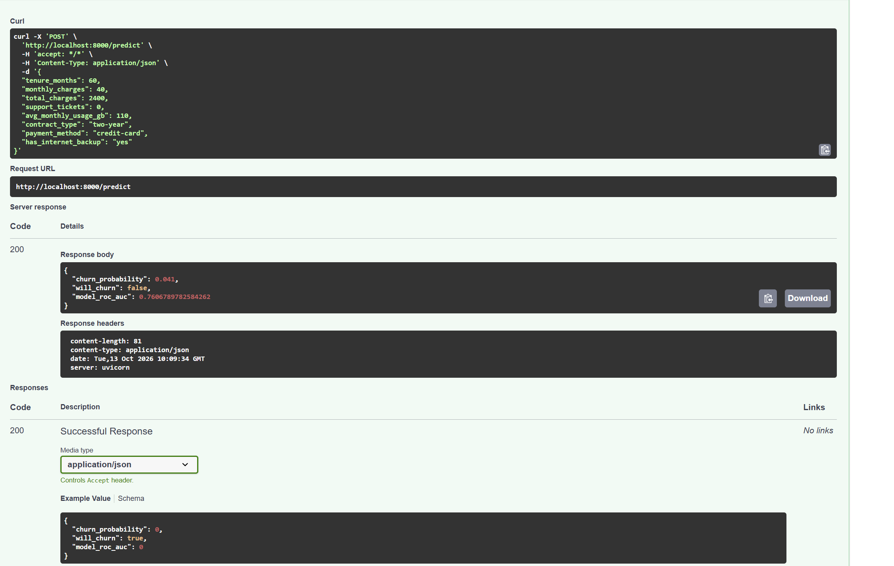

# Churn MLOps: an end-to-end ML pipeline with CI/CD


A customer-churn model taken from training to a published, scanned container image, with the automation an MLOps team expects: **experiment tracking, a model quality gate, containerised serving, vulnerability scanning, automated publishing, and monitoring.**

Every push to `main` is linted, tested, retrained, gated, built, scanned, and pushed to Docker Hub automatically.



## Architecture



## What this project demonstrates

| Concern | Implementation |
|---|---|
| Reproducible training | Seeded synthetic dataset, single scikit-learn `Pipeline` (preprocessing + GradientBoosting) shipped as one artifact |
| Experiment tracking | MLflow logs params, metrics, the model, and the quality-gate verdict for every run |
| Model quality gate | Training exits non-zero if ROC AUC is below a floor or regresses against the current production model, which stops the pipeline |
| Serving | FastAPI with validated inputs (Pydantic), `/health`, `/predict`, `/metrics` |
| Packaging | Multi-stage Dockerfile, non-root user, container healthcheck |
| CI/CD | GitHub Actions: lint, test, train, build, scan, push, deploy |
| Supply-chain security | Trivy fails the build on fixable HIGH/CRITICAL CVEs; secrets only in GitHub Secrets |
| Monitoring | Prometheus metrics: latency, request counts, prediction distribution (drift signal) |

## Screenshots

**Quality gate in MLflow**: runs compared side by side, with the gate verdict recorded as a tag.



**Published image on Docker Hub**: built, scanned and pushed by the pipeline.



**The API reacting to inputs**: a risky customer versus a loyal one.

| High-risk customer (month-to-month, 12 months) | Loyal customer (two-year, 60 months) |
|---|---|
|  |  |

## Quickstart

Requires Python 3.10+.

```bash
# create and activate a virtual environment
python -m venv .venv
source .venv/bin/activate        # Windows PowerShell: .venv\Scripts\Activate.ps1

pip install -r requirements-dev.txt
pytest

# train (applies the quality gate and writes models/model.joblib)
PYTHONPATH=src python -m churn_mlops.train        # PowerShell: $env:PYTHONPATH="src"; python -m churn_mlops.train

# serve
PYTHONPATH=src uvicorn churn_mlops.api:app --reload
# open http://localhost:8000/docs
```

Browse experiments with `mlflow ui` and open http://localhost:5000.

Run the published image instead:

```bash
docker run -p 8000:8000 ruchitasingla/churn-mlops-api:latest
```

Example request:

```bash
curl -X POST localhost:8000/predict -H 'Content-Type: application/json' -d '{
  "tenure_months": 3, "monthly_charges": 95, "total_charges": 285, "support_tickets": 4,
  "avg_monthly_usage_gb": 80, "contract_type": "month-to-month",
  "payment_method": "e-wallet", "has_internet_backup": "no"}'
```

## Monitoring stack (Docker Desktop)

```bash
docker compose up --build -d     # api :8000 | mlflow :5000 | prometheus :9090 | grafana :3000 (admin/admin)
python scripts/send_traffic.py --n 200                # normal traffic
python scripts/send_traffic.py --n 200 --drift 1.0    # drifted traffic
```

The drifted traffic shifts the `churn_probability` histogram in Prometheus, which is how a stale model would show up in production.

## The quality gate

`src/churn_mlops/train.py` evaluates on a held-out split and refuses to promote a model when:

1. `roc_auc < MIN_ROC_AUC` (default 0.70), or
2. it regresses against `models/metrics.json` (the current production model) by more than `MIN_IMPROVEMENT` (default -0.005).

A failed gate returns exit code 1, which fails the `train` job before anything is built or deployed. Both thresholds are configurable through environment variables. The small negative tolerance absorbs run-to-run noise but allows slow drift over many retrains, so set `MIN_IMPROVEMENT=0` for a strict gate.

## CI/CD setup

Add these under **Settings, Secrets and variables, Actions**:

| Name | Type | Value |
|---|---|---|
| `DOCKERHUB_USERNAME` | Secret | Docker Hub username (lowercase) |
| `DOCKERHUB_TOKEN` | Secret | Docker Hub access token (Read & Write) |
| `EC2_HOST`, `EC2_USER`, `EC2_SSH_KEY` | Secret | Deployment target (only needed for deploy) |
| `DEPLOY_ENABLED` | Variable | `true` to switch the deploy job on |

Pull requests run everything up to the scan. Only pushes to `main` publish the image. The deploy job is opt-in and ends with a health check that fails the run if the new container is unhealthy.

## Lessons learned while building this

- **The scanner earned its keep.** Trivy blocked the first build because the pinned FastAPI pulled in a Starlette version with three HIGH CVEs. Fixing it meant upgrading FastAPI and pinning a patched Starlette.
- **Pin CI actions carefully.** A tag-pinned action I first used no longer resolved after a 2026 supply-chain compromise of its tags. Pinning to a full commit SHA is the stronger practice.
- **Secrets never belong in files.** GitHub push protection caught a token pasted into the workflow before it reached the repository.
- **Docker image names must be lowercase**, so the pipeline normalises the name derived from the Docker Hub username.

## Project layout

```
src/churn_mlops/   config, data generator, model pipeline, training + gate, FastAPI app
tests/             data, gate logic, training promotion/blocking, API contract and metrics
monitoring/        Prometheus + Grafana provisioning
scripts/           traffic / drift simulator
docs/              screenshots
.github/workflows/ ci-cd.yml
```

## Roadmap

- Compare against the last *deployed* model in CI (persist `metrics.json` in S3 or an MLflow registry stage) instead of only the absolute AUC floor.
- Scheduled drift check (Evidently) that triggers a retraining workflow.
- Terraform for the EC2 instance, security group and key pair.
- Pin all GitHub Actions to commit SHAs.
- Blue/green or canary deploys; a committed Grafana dashboard.

> This project uses a synthetic dataset for demonstration purposes.